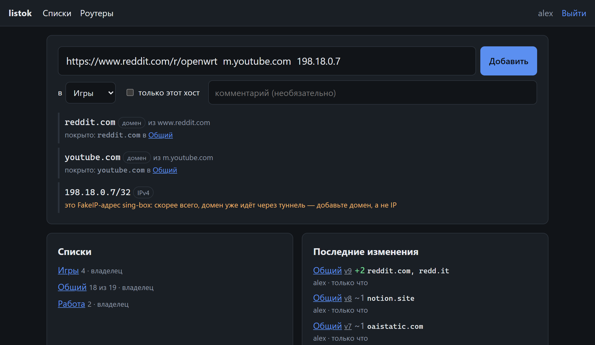
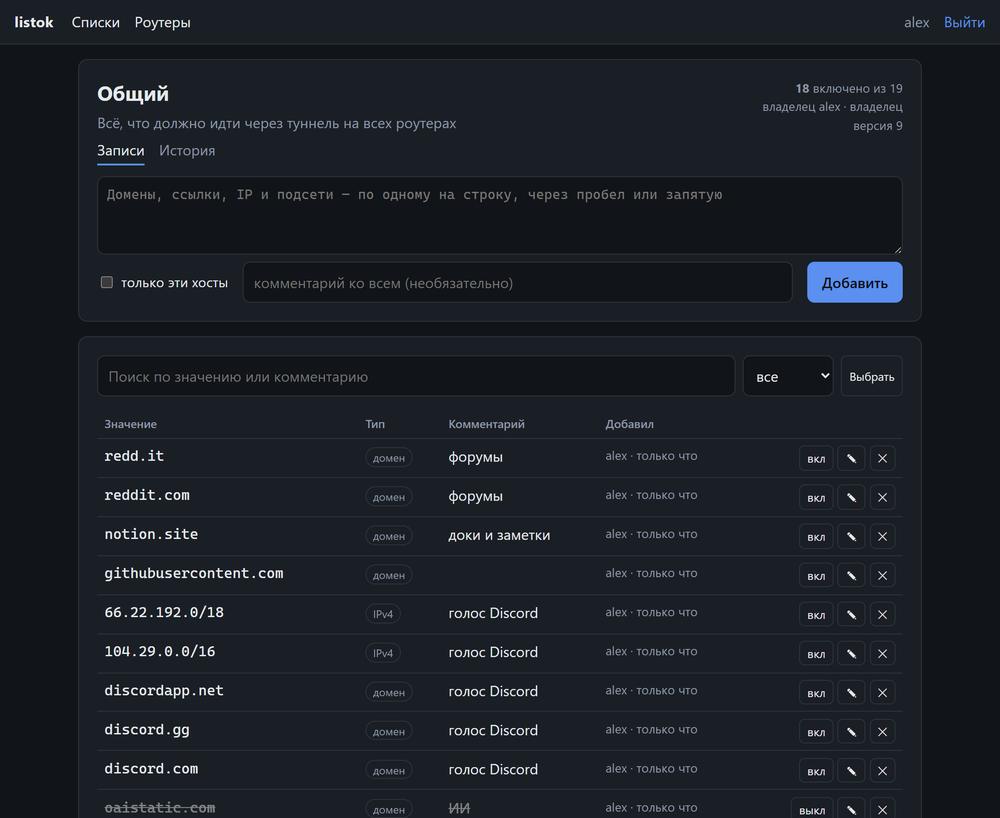
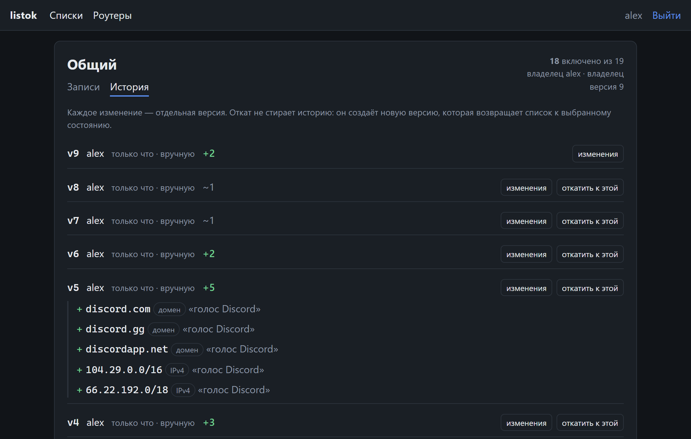

#  listok

**Единые списки обхода для всех ваших роутеров с forkop.**

listok — небольшой самохостящийся веб-сервис для роутеров с [forkop](https://github.com/ushan0v/forkop) (форк [podkop](https://github.com/itdoginfo/podkop), OpenWrt + sing-box). Списки доменов и подсетей ведутся в браузере, а роутеры забирают их по ссылке. Не нужно заходить в LuCI на каждом роутере и переносить одни и те же правки вручную.

```
 браузер / телефон ──► listok ──► https://<домен>/f/<секрет>.lst ──► роутер A
                       (Go + SQLite)                             ├─► роутер B
                                                                 └─► роутер C
```

<p align="center">
  
</p>

## Возможности

- **Быстрое добавление.** Вставьте ссылку — `https://www.youtube.com/watch?v=…` превратится в `youtube.com`. До сохранения видно, что добавится, не покрыто ли это уже и нет ли ошибки (FakeIP-адрес, частный диапазон, `co.uk` целиком).
- **Несколько списков** с разным составом для разных роутеров: у каждой секции forkop (`main`, `geo`, …) свой набор списков.
- **Импорт и экспорт.** Список выгружается текстовым файлом (запись на строку, с комментариями) и загружается в другой listok — так списками удобно делиться.
- **История и откат.** Каждое изменение — версия; видно, кто и что поменял, список можно вернуть к любой версии.
- **Статус роутеров.** На связи ли агент и применились ли изменения в каждой секции forkop.
- **Расширение для Chrome и команда для iPad.** Текущий сайт и незагрузившиеся ресурсы страницы добавляются двумя нажатиями, без входа в listok.
- **Лёгкий.** Один бинарник на Go, SQLite, интерфейс без сборки фронта (htmx). Подойдёт любой сервер с Docker — домашний или VPS.

<table>
  <tr>
    <td width="50%"></td>
    <td width="50%"></td>
  </tr>
  <tr>
    <td align="center"><sub>Список: поиск, комментарии, вкл/выкл записей</sub></td>
    <td align="center"><sub>История: что изменилось и откат к любой версии</sub></td>
  </tr>
</table>

## Быстрый старт

Нужны Docker и домен с HTTPS через любой reverse proxy (Caddy, Nginx Proxy Manager, Traefik, …).

```yaml
# compose.yml
services:
  listok:
    image: ghcr.io/bastearima/listok:latest
    restart: unless-stopped
    ports:
      - "127.0.0.1:8080:8080"      # наружу — только через reverse proxy с HTTPS
    environment:
      LISTOK_BASE_URL: https://listok.example.com
      LISTOK_TRUSTED_PROXY: 127.0.0.1/32,172.16.0.0/12   # откуда приходит reverse proxy
    volumes:
      - listok-data:/data
volumes:
  listok-data:
```

```bash
docker compose up -d
docker compose logs listok | grep setup_token
```

Откройте свой домен, введите setup-токен из лога и создайте администратора. Либо задайте `LISTOK_ADMIN_USER` и `LISTOK_ADMIN_PASSWORD` — тогда администратор создастся при первом запуске.

Пример для Caddy:

```
listok.example.com {
	reverse_proxy 127.0.0.1:8080
}
```

## Подключение роутера

1. В listok: **Роутеры → добавить**, на странице роутера скопировать готовую команду установки и выполнить её на роутере под root. Если роутер в той же сети, что сервер listok, укажите IP сервера в этой сети — команда поменяется сама. Для слабых роутеров есть экономный режим: проверка раз в N минут вместо постоянного соединения.
2. Агент сам пришлёт секции forkop. На странице роутера нажмите **«Подключить секцию»** у нужной (forkop перезапустится один раз) и отметьте списки — изменения доходят до роутера за секунды, без перезапуска sing-box. Удалить агент: `listok-agent uninstall`.
3. **Без агента**: «Подключить секцию вручную» (название как в колонке «Name» на вкладке Sections в LuCI forkop), отметить списки, скопировать ссылку из «Ссылки для forkop без агента» в LuCI → forkop → секция → **Наборы правил** с флажком «Учитывать IP-адреса и подсети» (в forkop 1.x — **Domain and IP lists**) → «+» → Save & Apply. forkop перекачивает список раз в сутки.

Файл секции — обычный `.lst`: по записи на строку, домены и подсети вместе. Первая строка `listok-sentinel.invalid` служебная: благодаря ей forkop подхватывает новые записи без перезапуска sing-box.

## Расширение и iPad

На вкладке **Подключения** создайте токен. Там же расширение для Chrome (Windows, Mac) и команда в меню «Поделиться» для iPad и iPhone. Расширение показывает и домены, которые не загрузились на странице: их часто и нужно пускать через туннель. Магазин приложений и аккаунт разработчика не нужны. Подробнее: [docs/extension.md](docs/extension.md).

## Настройки

| Переменная | По умолчанию | |
|---|---|---|
| `LISTOK_BASE_URL` | — | **обязательно**, внешний адрес сервиса |
| `LISTOK_ADMIN_USER`, `LISTOK_ADMIN_PASSWORD` | — | создать администратора при первом запуске |
| `LISTOK_TRUSTED_PROXY` | `172.16.0.0/12` | подсети reverse proxy (для настоящего IP клиента) |
| `LISTOK_BACKUP_KEEP` | `14` | ежедневные бэкапы БД в `/data/backups`; `0` — выключить |
| `TZ` | `UTC` | часовой пояс для логов и имён бэкапов |

## Статус

Готово к использованию: списки, история, роутеры и секции forkop, агент для роутера (изменения доходят за секунды через long-poll). Пока один пользователь — администратор. Дальше — совместное ведение (пользователи, роли, предложения изменений) и подсказки, какие домены сайта ещё идут мимо туннеля. План — [docs/roadmap.md](docs/roadmap.md).

Проверено с forkop 1.0.x и sing-box 1.14. С forkop 2.0 (агент 0.3.1 и новее) изменения применяются примерно за секунду. Подключение и отключение секций из интерфейса (агент 0.4.0) пока проверено только в тестовом контейнере OpenWrt.

## Разработка

```bash
go test ./...
LISTOK_BASE_URL=http://127.0.0.1:8080 LISTOK_DATA=./data go run ./cmd/listok
```

Устройство и принятые решения — в [docs/](docs/), карта документации — в [AGENTS.md](AGENTS.md).

## Лицензия

[GPL-3.0](LICENSE).
